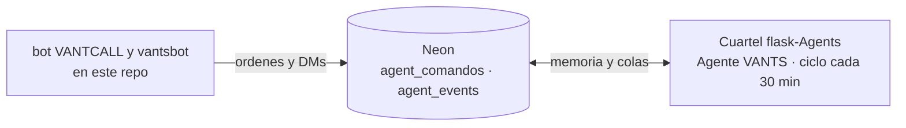

# Agentes: el cuartel es flask-Agents

**Anuncio del ecosistema VANTS GAMES:** el cuartel de los agentes es
[`VANTSNET/flask-Agents`](https://github.com/VANTSNET/flask-Agents). Ahí vive
el código de todos los agentes, los viejos y los nuevos, como única fuente de
verdad. La web del cuartel es https://vants-ai.vercel.app/

| Pieza | Dónde vive ahora |
|---|---|
| Núcleo del Agente VANTS (`services/agent-service`) | Cuartel: `VANTSNET/flask-Agents` |
| Ciclo `agente.yml` (cada 30 min, guarda anti-bucle) | Cuartel |
| Tests del núcleo (83 + 60 + 30 asserts) | Cuartel, en `scripts/` |
| Migraciones 25 y 26 (memoria `agent_*` de Neon) | `VantsBasededatos` y copia en el cuartel |
| Puente ORION (`agent_bridge.py` + `commands/agente.py`) | Referencia en el cuartel (`bot-agente/`); el cliente activo es el `bot/` de este repo |
| Neon Function `vantsbot` (`/agente` + DMs) | `neon-functions/vantsbot` de este repo, desplegada por CI |
| Consumidor viejo de VANTS-BUS | Cuartel: `vants_bus/` |
| Web VANTS AI (squad, chat GLM) | Cuartel; web publicada en Vercel |

## Qué queda en este repo (limpio de código de agentes)

- El **bot VANTCALL** (`bot/`) con sus comandos de comunidad y su parte
  cliente `/agente`: escribe en las colas de Neon (`agent_comandos`,
  `agent_events`) y entrega los DMs. No importa nada del núcleo.
- La **Neon Function `vantsbot`** (`neon-functions/vantsbot`): el mando de
  `/agente` por el Interactions endpoint de Discord y los DMs del puente tras
  cada ciclo del cuartel.

## Cómo se habla con el agente

## Por qué se retiró el workflow `agente.yml` de este repo

Hasta la limpieza el mismo ciclo corría **dos veces** cada 30 minutos
(`vants-dev-launcher` y `Vantsgames`) contra la misma Neon: doble vigilancia,
doble escritura en `agent_runs` y dos canales de re-despliegue. Ahora corre
**una sola vez desde el cuartel**, que vigila esta plataforma con el mismo
código. Las migraciones 25 y 26 siguen viviendo en `db/migrations/` del repo
`VantsBasededatos`, que las aplica a Neon; aquí ya no hay copia.

Variables del cliente: `bot/.env.example` (`AGENT_URL`, `AGENT_TOKEN`,
`AGENTE_BRIDGE_INTERVAL`).
